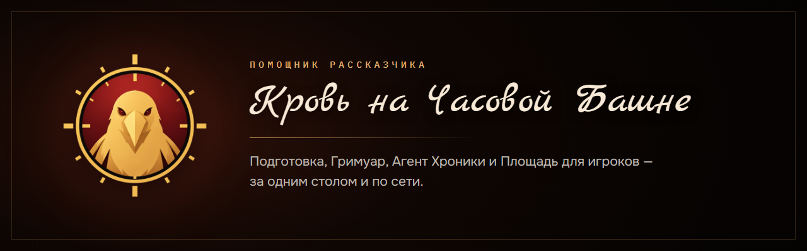
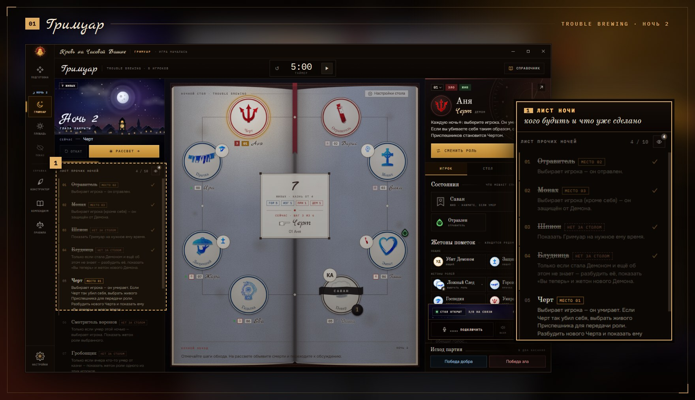
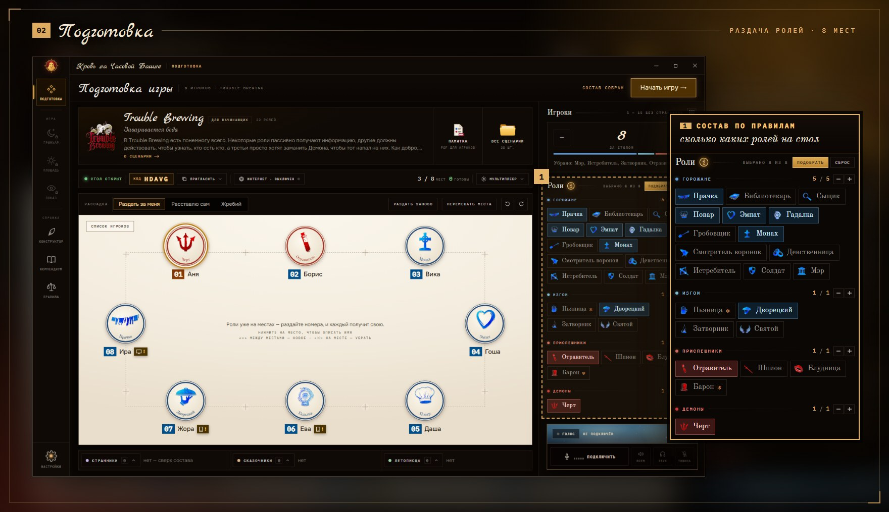
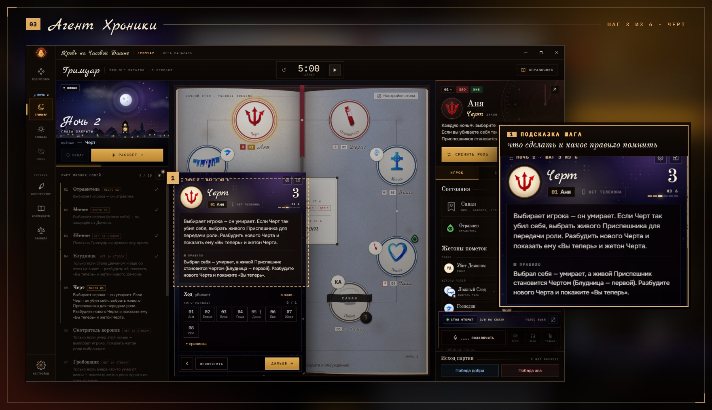
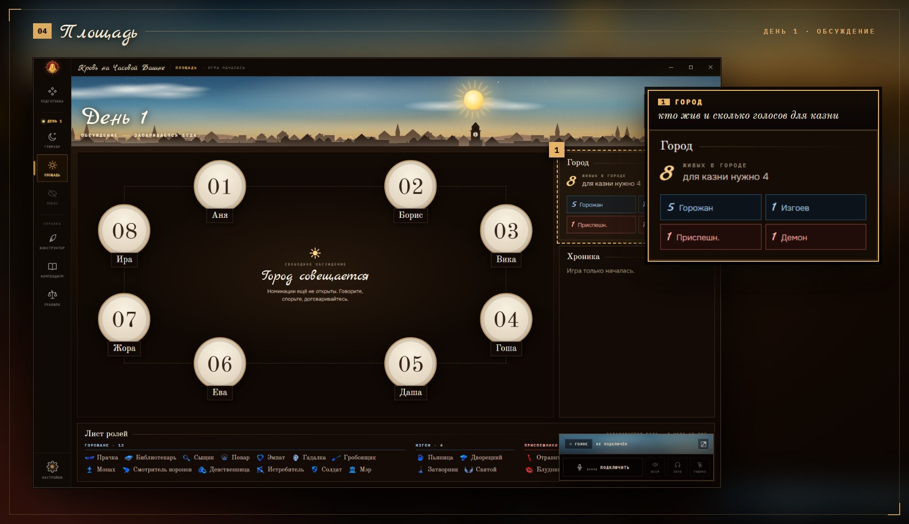
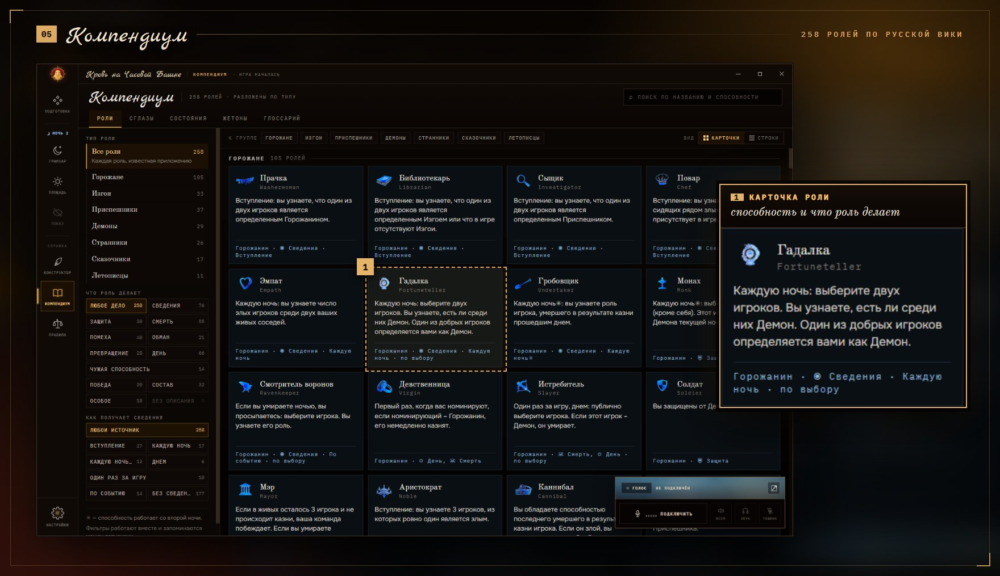
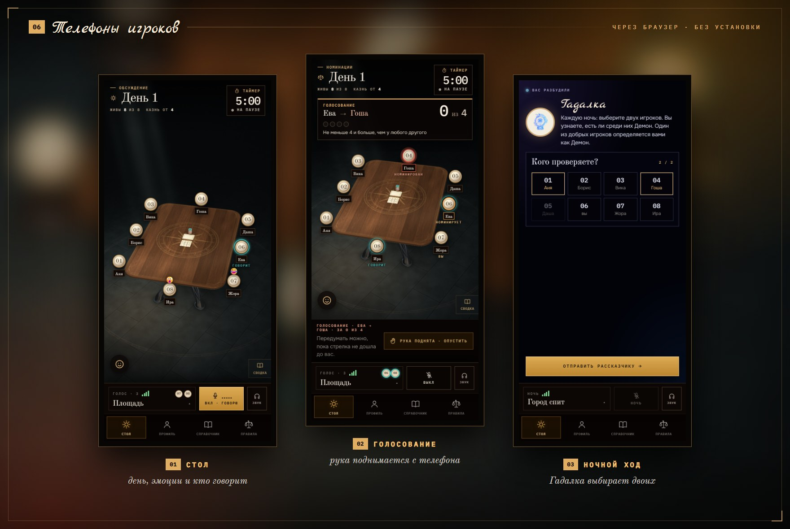
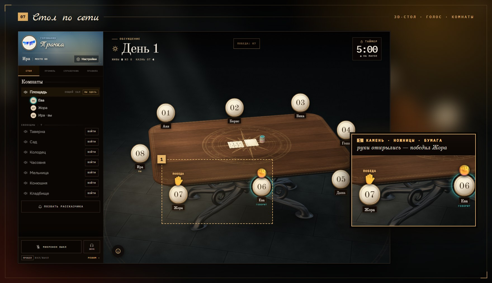
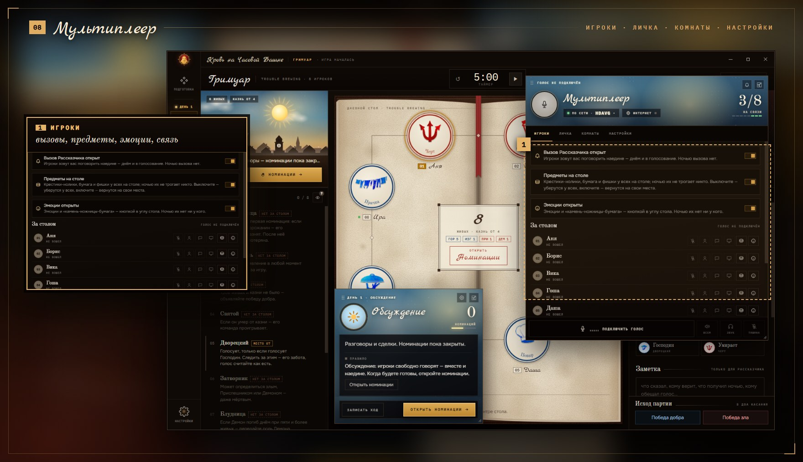

<p align="center">
  
</p>

<p align="center">
  <b>Помощник Рассказчика для Blood on the Clocktower — для стола и для игры по сети</b>
</p>

<p align="center">
  <a href="https://github.com/Quillnight/BOTC/releases/latest"><b>Скачать последнюю версию</b></a>
  &nbsp;·&nbsp; <a href="#что-умеет">Что умеет</a>
  &nbsp;·&nbsp; <a href="#игра-по-сети">Игра&nbsp;по&nbsp;сети</a>
  &nbsp;·&nbsp; <a href="#установка">Установка</a>
  &nbsp;·&nbsp; <a href="#частые-вопросы">Вопросы</a>
</p>

<p align="center">
  <sub>Windows&nbsp;10&nbsp;и&nbsp;11 &nbsp;·&nbsp; Linux &nbsp;·&nbsp; 38&nbsp;сценариев &nbsp;·&nbsp; 258&nbsp;ролей</sub>
</p>



## Коротко

- **Рутину берёт на себя.** Раздаёт роли по правилам подготовки, ведёт лист ночи и напоминает, кого будить и что положить на стол.
- **Помнит правила.** К шагам ночи — подсказки с последствиями смертей, отравлений и сглазов.
- **Подключает игроков.** Город, голосование и ночные ходы — на телефонах игроков, через браузер, без установки.
- **Играет и по сети.** Трёхмерный стол, голосовая связь, комнаты для разговоров с глазу на глаз и вход через интернет — всё внутри приложения.

> [!NOTE]
> Здесь лежат только выпуски — архивы для скачивания и файлы, по которым приложение само узнаёт об обновлениях. Исходного кода в этом репозитории нет.

---

## Что умеет

### Подготовка

*Сценарий, игроки и раздача ролей — за пару минут.*

- **Состав по правилам.** Приложение считает Горожан, Изгоев, Приспешников и Демона для любого числа игроков и учитывает тех, кто меняет состав, — Барона, Пьяницу, Марионетку, Охотника за головами.
- **Три способа раздать.** «Раздать за меня», расставить роли самому или тянуть жребий.
- **Отмеченные сценарии.** Сценарии с меткой «Проверен» сверены с вики целиком, вместе с ходом партии: Trouble Brewing, Sects & Violets, Pies Baking, Everyone Can Play и Al vs Al.



### Агент Хроники

*Ведёт ночь по шагам и знает, что делать на каждом.*

- **Что сделать.** Кого разбудить, что показать и какой жетон положить — коротко, по листу ночи сценария.
- **Какое правило помнить.** Под шагом — тонкость роли: кто становится Демоном, когда снимается отравление, что меняет сглаз.
- **Всё в Хронику.** Каждый ход записывается; днём Агент подсказывает по номинациям и голосованию.



### Площадь

*Город для игроков — на общем экране.*

- **Кто жив, кто мёртв.** И сколько голосов нужно для казни сегодня.
- **Номинации и итоги.** Кто кого выдвинул и чем закончилось голосование.
- **Свой экран.** Площадь открывается отдельно от Гримуара — её можно вывести на проектор или второй монитор.



### Компендиум и Конструктор

*Справка под рукой и свои сценарии.*

- **Компендиум.** Все роли, сглазы, состояния и жетоны по русской вики, с фильтрами по типу и по тому, что роль делает.
- **Правила.** Сама игра и её подготовка — в отдельном разделе.
- **Конструктор.** Свои сценарии; памятки и отчёт о партии сохраняются в PDF.



---

## Игра по сети

Игроки подключаются со своих телефонов или компьютеров — через браузер, по ссылке-приглашению, коду стола или QR-коду. За одной партией могут сидеть и те, кто рядом, в одной сети Wi-Fi, и те, кто играет через интернет. Как играете — «За столом» или «По сети», — выбирается в окне «Мультиплеер» на Подготовке.



#### За столом

Все сидят вместе, а телефоны помогают Рассказчику.

- **Площадь и справочник** у каждого на телефоне, плюс личные заметки — они хранятся только на устройстве игрока.
- **Своя роль на устройстве** — если Рассказчик включил «Роли на устройствах», игрок видит свою роль и только её.
- **Личные сообщения** от Рассказчика появляются только ночью, чтобы никто не подсмотрел.
- **Места за столом** игроки до начала партии занимают сами или просят соседа поменяться — если Рассказчик разрешил.

#### По сети

Вся игра в приложении, без отдельного голосового чата.

- **Стол.** У игроков Площадь — трёхмерный дубовый стол с жетонами мест: его можно вращать, наклонять и приближать. На столе — крестики-нолики, стопка бумаги для рисования и фишки: их видят и двигают все. Эмоции всплывают над местом игрока, а в «камень-ножницы-бумагу» играют все желающие. Ночью предметы и эмоции отключаются.
- **Сводка партии** открывается поверх стола: какой день, кто жив, порог казни, голоса мёртвых, игроки, хроника и лист ролей.
- **Голос** идёт через компьютер Рассказчика: Площадь для всех и семь комнат для разговоров с глазу на глаз — Таверна, Сад, Колодец, Часовня, Мельница, Конюшня и Кладбище. Дверь комнаты можно закрыть — тогда войти можно только по приглашению. Шумоподавление работает прямо на устройстве и убирает вентилятор, гул и клавиатуру.
- **Ночью** Агент будит игрока голосом, на телефоне появляется его способность и выбор целей, а ответ сразу заполняет ход. Что игрок узнал, уходит ему карточкой.
- **Днём** игроки поднимают руку в голосовании и подают заявку на номинацию с телефона, а Рассказчик принимает её или отклоняет. Вопрос по игре Рассказчику можно задать в личке.



#### Окно «Мультиплеер»

Рассказчик ведёт игру по сети из одного окна прямо в Гримуаре.

- **Игроки** — кто на связи, кто зовёт Рассказчика и кто ждёт у входа; у каждого игрока — громкость, «Заглушить», «Разбудить», «Написать» и трансляция его экрана.
- **Стол** — убрать все предметы или эмоции и вернуть их, запретить их отдельному игроку.
- **Личка** — переписка с игроками, которую видят только двое.
- **Комнаты** — войти открыто или тайно, переименовать, закрыть, перевести игрока или собрать всех на Площадь.



> [!TIP]
> Для игры через интернет приложение само поднимает защищённый туннель Cloudflare. Если есть свой VPS — «Подключение к серверу»: владелец ставит его из приложения и раздаёт друзьям коды доступа, а столы нескольких Рассказчиков открываются через один сервер. Голосовая связь работает именно при игре через интернет: браузер даёт доступ к микрофону только по защищённой ссылке.

---

## Установка

| Система | Какой архив | Что нужно |
|---|---|---|
| Windows 10 и 11 | `BOTC_<версия>_windows_x64.zip` | WebView2 и .NET Framework 4.7.2 — обычно уже есть; без WebView2 приложение предложит поставить его само |
| Linux x86-64 | `BOTC_<версия>_linux_x64.tar.gz` | Для своего окна — Chrome, Chromium, Edge, Brave или Vivaldi; без них подойдёт любой браузер. Python и cloudflared уже внутри |

Оба архива — в [последнем выпуске](https://github.com/Quillnight/BOTC/releases/latest). Для macOS и Linux на процессорах ARM сборки пока нет. Партии и настройки хранятся отдельно от папки программы, так что её можно заменить новой версией — ничего не пропадёт. Дальше приложение обновляется само.

### Windows

1. Распакуйте `BOTC_<версия>_windows_x64.zip` в удобную папку — например, в «Документы». Не в Program Files: оттуда приложение не сможет обновляться само.
2. Запустите `BOTC.exe` в папке `BOTC`.

Если своё окно приложения почему-то не откроется, оно откроется в браузере и будет работать там.

### Linux

```sh
tar xzf BOTC_*_linux_x64.tar.gz
sh BOTC/start.sh
```

Приложение откроется своим окном, если в системе есть Chrome, Chromium, Edge, Brave или Vivaldi, а без них — вкладкой браузера. Ярлык в меню приложений добавит `sh BOTC/make-shortcut.sh` — папку программы после этого не переносите.

> [!TIP]
> Закрыли окно — приложение выключилось. Если оно открыто вкладкой, закончить можно Ctrl+C в терминале или просто закрыть вкладки: через 3–4 минуты приложение выключится само.

---

## Частые вопросы

<details>
<summary><b>Windows пишет «Система Windows защитила ваш компьютер»</b></summary>
<br>
Нажмите «Подробнее», затем «Выполнить в любом случае». У приложения нет платной цифровой подписи, которую проверяет Windows, и она так встречает любую программу без неё. Окно появляется только при первом запуске скачанного архива — обновления ставятся без него.
</details>

<details>
<summary><b>Где хранятся партии и настройки?</b></summary>
<br>

- **Windows** — `%APPDATA%\BOTC`: там и партии, и настройки, и свои сценарии.
- **Linux** — `~/.botc`: партии, настройки и свои сценарии. Если приложение открыто вкладкой, а не своим окном, настройки хранит ещё и браузер.

Папку программы можно удалить или заменить новой версией — партии и настройки при этом не пропадут.
</details>

<details>
<summary><b>Игроки не могут подключиться с телефонов</b></summary>
<br>
Стол на Подготовке должен быть открыт. Игроки рядом входят из той же сети Wi-Fi, что и компьютер Рассказчика; при первом запуске Windows спрашивает, пускать ли приложение в сеть, — разрешите для частных сетей. Для тех, кто не рядом, нужен «Вход из интернета» в окне «Мультиплеер»: в режиме «По сети» он включается сам, когда открываете стол, и приложение даёт ссылку, по которой можно войти откуда угодно. В архивах для Windows и Linux всё для этого уже есть.
</details>

<details>
<summary><b>На Linux стоит версия старше 2.0.1</b></summary>
<br>
До 2.0.1 на Linux запускали архив для Windows, а теперь он работает только на Windows. Скачайте сборку для Linux и распакуйте её вместо прежней папки — партии останутся в <code>~/.botc</code>.
</details>

<details>
<summary><b>Как удалить приложение со всеми данными?</b></summary>
<br>
Закройте приложение и удалите две папки: папку данных (см. вопрос выше) и папку программы. Если на Linux приложение открывалось вкладкой, очистите ещё данные сайта <code>127.0.0.1</code> в браузере.
</details>

<details>
<summary><b>Нашли ошибку</b></summary>
<br>
Опишите, что случилось, в <a href="https://github.com/Quillnight/BOTC/issues">Issues</a>. Если приложение упало или не открылось, приложите файл <code>error.txt</code> или <code>window-error.txt</code> из папки данных, а если не встало обновление — <code>update/update.log</code>.
</details>

---

<sub>Неофициальное фанатское приложение. Blood on the Clocktower — игра The Pandemonium Institute; приложение с ними не связано. Тексты ролей — по русской вики <a href="https://botc.1nv.is">botc.1nv.is</a>.<br>Приложение создано с помощью Claude и ChatGPT.</sub>
